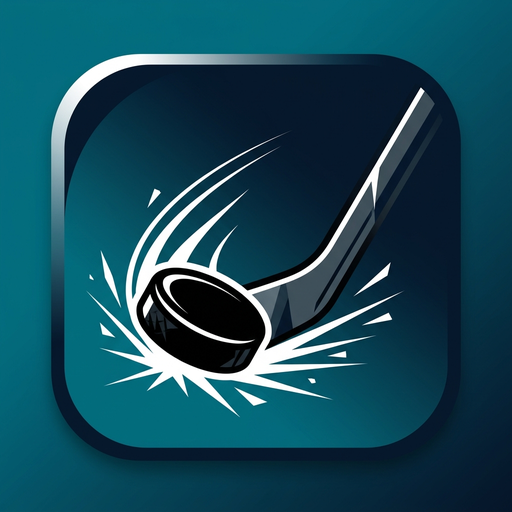

<p align="center">
  
</p>

# Sharks Ice Locker Room Widget (Flutter — iOS & Android)

A cross-platform Flutter app and home screen widget (`home_widget` + `workmanager`) that scrapes today's games and locker room assignments from [TimeToScore (`display-lr-assignments.php`)](https://stats.sharksice.timetoscore.com/display-lr-assignments.php) and displays your selected teams' games and locker room numbers right on your iPhone or Android home screen.

## Features
- **Current-Day Locker Room Scraper (`TimeToScoreParser`)**: Parses `https://stats.sharksice.timetoscore.com/display-lr-assignments.php` (San Jose & Fremont) and `https://stats.oaklandice.timetoscore.com/display-lr-assignments.php` (Oakland) to extract game times, rinks, divisions, home/away teams, and assigned locker rooms.
- **Facility Selection**: Choose which Sharks Ice facilities to include (**San Jose**, **Fremont**, **Oakland**) in the Settings screen.
- **Multi-Team Picker**: Search and select all SIAHL teams you play on (auto-discovered from TimeToScore + custom team entry).
- **Native Home Screen Widgets**:
  - **iOS (`WidgetKit` / SwiftUI)**: Supports `systemSmall` and `systemMedium` widget families via App Group `group.com.makeshiftlabs.sharks_ice_locker_widget`.
  - **Android (`AppWidgetProvider` / Kotlin)**: Resizable home screen widget reading shared data from `HomeWidgetProvider`.

## Quick Start

1. Generate any missing platform scaffolding files if starting from a fresh checkout:
   ```bash
   mkdir -p /tmp/sharks_backup
   cp -r lib test ios android pubspec.yaml /tmp/sharks_backup/
   flutter create . --org com.makeshiftlabs --project-name sharks_ice_locker_widget
   cp /tmp/sharks_backup/pubspec.yaml pubspec.yaml
   cp -r /tmp/sharks_backup/lib/* lib/
   cp -r /tmp/sharks_backup/test/* test/
   cp -r /tmp/sharks_backup/ios/* ios/
   cp -r /tmp/sharks_backup/android/app/src/main/* android/app/src/main/
   sed -i '' 's/IPHONEOS_DEPLOYMENT_TARGET = [0-9.]*;/IPHONEOS_DEPLOYMENT_TARGET = 16.0;/g' ios/Runner.xcodeproj/project.pbxproj
   flutter pub get
   flutter build ios --config-only
   open ios/Runner.xcworkspace
   ```
2. **iOS Setup (Xcode)**:
   - Open `ios/Runner.xcworkspace` in Xcode.
   - Add a **Widget Extension** target named `LockerRoomWidget` and replace its generated Swift file with `ios/LockerRoomWidget/LockerRoomWidget.swift`.
   - Enable the **App Groups** capability (`group.com.makeshiftlabs.sharks_ice_locker_widget`) on both the `Runner` target and the `LockerRoomWidget` target.
3. **Android Setup**:
   - `LockerRoomWidgetProvider.kt`, `res/layout/locker_room_widget.xml`, `res/xml/locker_room_widget_info.xml`, and `AndroidManifest.xml` are pre-configured.
   - Run `flutter run` on your Android device, then long-press your home screen -> **Widgets** -> **Sharks Ice Locker Widget**.
